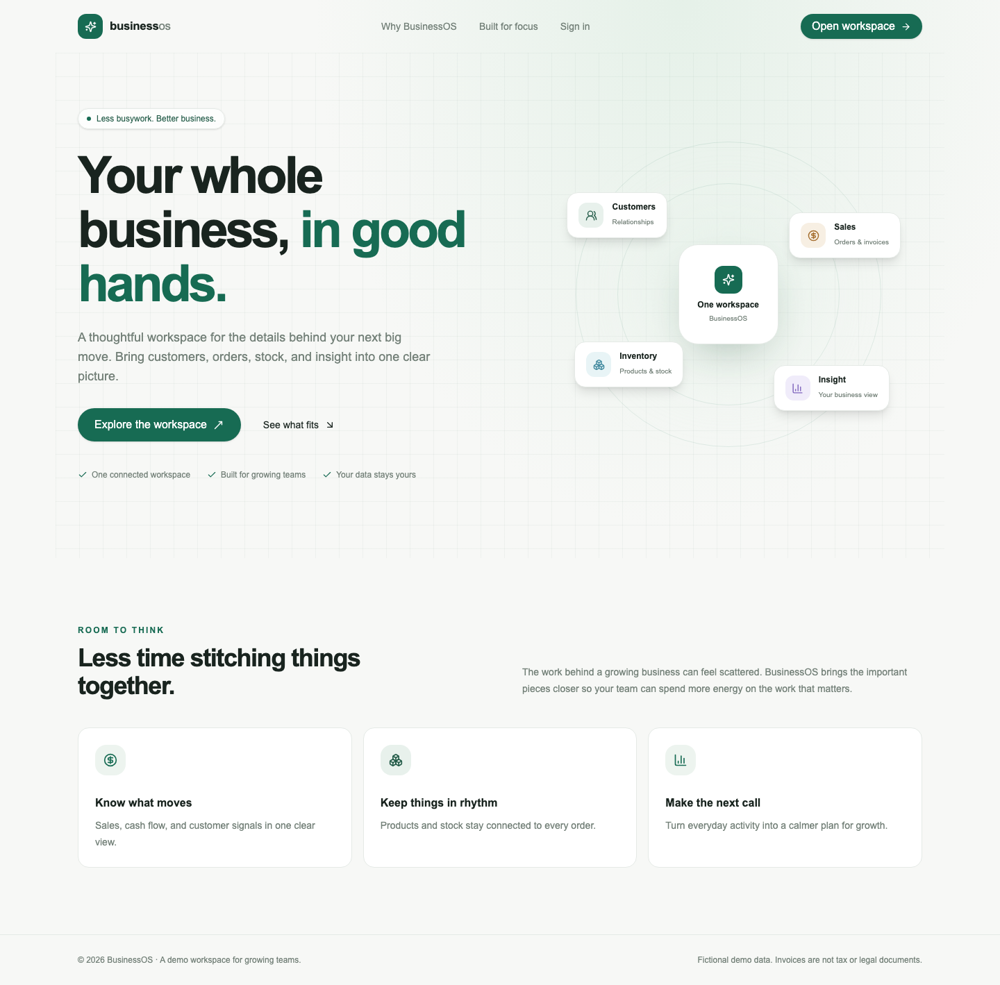
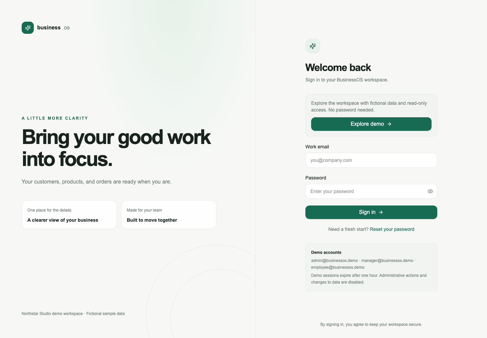
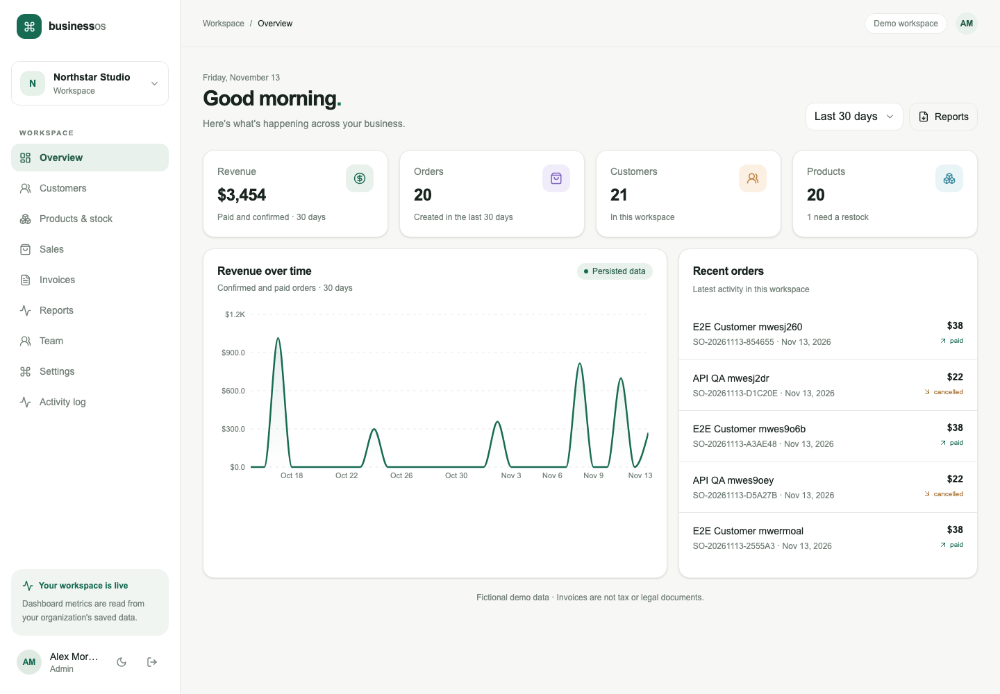
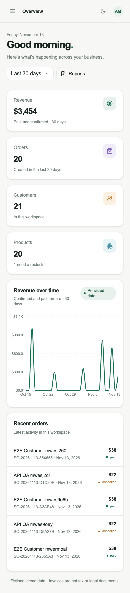
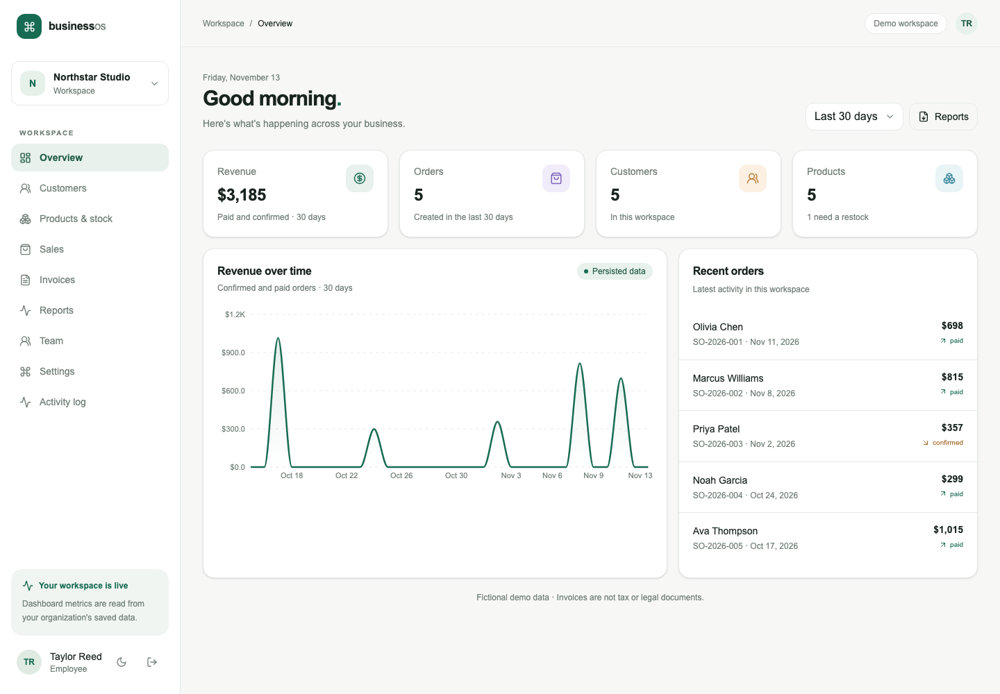
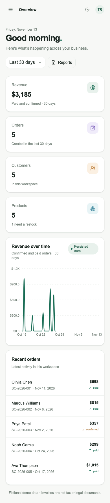

# BusinessOS ERP

[](https://github.com/cristoferdiazalvarez/businessos-erp/actions/workflows/ci.yml)

**A full-stack ERP SaaS portfolio built with Next.js, NestJS, TypeScript, PostgreSQL and Prisma.**

BusinessOS is a multi-tenant ERP demo for growing teams. It brings customer records, catalog and inventory, orders, invoices, team access, reporting, and operational signals into one workspace.

> **Portfolio/demo project.** The seeded organizations and people are fictional. Invoice PDFs and numbers are workflow examples only; they are not tax, accounting, or legal documents. PostgreSQL migrations, seeds, API integration checks and browser E2E flows have been verified locally, including compiled web/API servers. This is a demo, not a production deployment certification.

**[Open the live demo](https://businessos-web-five.vercel.app)** · Select **Explore demo** for a one-hour, read-only employee session. No password or installation is needed.

## Product preview

| Public landing | Sign in |
| --- | --- |
|  |  |

The authenticated dashboard uses live API queries over persisted, organization-scoped data. Captures below come from the real database-backed application.

| Dashboard · desktop | Dashboard · mobile |
| --- | --- |
|  |  |

[All desktop/mobile captures](./docs/screenshots) cover landing, login, dashboard, customers, products, sales, invoices, reports, team, settings and activity. Mobile checks use a 390 × 844 Chromium viewport; they are not physical-device or Safari tests.

## Features

- **Workspace and identity:** responsive public landing, session-based login/logout, demo password recovery, account profile, theme preference, and a protected application shell.
- **Tenant security:** the API resolves the caller's current organization membership and role from the session; business endpoints do not trust a tenant ID supplied by the browser.
- **Dashboard:** period filters, revenue chart, order/customer/product/low-stock KPIs, and recent orders based on persisted records.
- **Customers:** tenant-scoped CRUD, search, pagination, tags, order history, validation, and audit events.
- **Products and inventory:** category and product CRUD, SKU and pricing, stock adjustments, inventory movement history, and low-stock indicators.
- **Orders and invoices:** server-calculated line totals, discounts, configurable tax and order totals; transactional stock reservation/restoration; order statuses; unique organization-scoped invoice numbers; downloadable demo PDFs.
- **Team:** employee listing, backend role administration, demo invitations, member removal, and activity history.
- **Reports:** date-filtered sales, product and customer aggregates with CSV downloads protected by the same tenant boundary.
- **Settings and audit:** profile, organization currency/tax preferences, saved light/dark theme, and tenant-scoped audit log.
- **Operational UX:** responsive layouts, accessible labels, loading/error/empty states, inline validation, retry actions, and notifications.

## Technology

- **Monorepo:** pnpm workspaces
- **Frontend:** Next.js App Router, React, TypeScript, Tailwind CSS 4, local shadcn-style UI primitives, TanStack Query, Recharts, Lucide, Sonner
- **Backend:** Node.js, NestJS, TypeScript, Zod, Swagger/OpenAPI
- **Persistence:** PostgreSQL, Prisma ORM, committed migrations and repeatable fictional seeds
- **Quality:** ESLint, TypeScript, Jest, Vitest, Playwright, GitHub Actions
- **Local database:** PostgreSQL 17 via Postgres.app (verified on Apple Silicon); Docker Compose alternative

## Architecture

`apps/web` renders the public site and authenticated workspace. It calls `apps/api` using credentialed JSON requests. The NestJS API owns authentication, authorization, request validation, business calculations, tenant scoping, audit logging, and persistence. Prisma transactions keep order, stock, and invoice writes consistent.

```text
Browser → Next.js web app → NestJS API → Prisma → PostgreSQL
                             ├─ Session, role, and tenant guards
                             ├─ Zod validation and server-side totals
                             └─ OpenAPI documentation
```

See [architecture](./docs/architecture.md), [API reference](./docs/api.md), and [architecture decisions](./docs/decisions.md).

## Demo accounts

The reproducible seed creates the fictional **Northstar Studio** organization and these users:

| Role | Email |
| --- | --- |
| Admin | `admin@businessos.demo` |
| Manager | `manager@businessos.demo` |
| Employee | `employee@businessos.demo` |

Set private passwords in `.env` before seeding. No passwords or external credentials are included in the repository. Seeded contacts use fictional `.test` addresses.

## Run locally

### Requirements

- Node.js 20.9+
- Corepack and pnpm 10.12.1
- Docker Compose, or a reachable PostgreSQL 15+ server

### Setup

The verified macOS binary route, including isolated database creation and start/stop commands, is documented in [local PostgreSQL](./docs/local-postgresql.md). It avoids compiling Homebrew dependencies. Use that route if Docker is unavailable; both routes preserve separate development and test databases.

For a fresh clone with Docker Compose:

```sh
# Install project-local pnpm shims when pnpm is not already on PATH.
mkdir -p .local/bin
corepack enable --install-directory .local/bin
export PATH="$PWD/.local/bin:$PATH"
pnpm install --frozen-lockfile
pnpm env:local
docker compose up -d postgres postgres-test
pnpm db:generate
pnpm db:migrate
pnpm db:seed
pnpm dev
```

`env:local` creates a mode-0600 `.env` with random local passwords and refuses to overwrite an existing file. You can instead copy `.env.example` and fill every password placeholder. The Docker route is provided but Docker startup was not executable on the validation machine. The PostgreSQL/Prisma commands were verified using Postgres.app.

- Web: <http://localhost:3000>
- API: <http://localhost:4000/api>
- Swagger: <http://localhost:4000/api/docs>
- OpenAPI JSON: <http://localhost:4000/api/openapi.json>

Sign in with one of the demo emails above and its corresponding password from your private local `.env`. Explore the dashboard, create a customer/product, adjust stock, create and pay an order, then download its invoice. Employee accounts can read business records but cannot mutate them; managers can operate sales/catalog and invite employees, while admin-only team/organization operations remain protected.

Set `WEB_ORIGIN`, `API_ORIGIN` and `NEXT_PUBLIC_API_URL` consistently when changing origins. The API uses credentialed CORS and exact mutation-origin checks.

### Database-backed integration and browser tests

```sh
pnpm e2e:prepare
pnpm --filter @businessos/web exec playwright install chromium
pnpm test:e2e
# Also exercise compiled server entry points:
pnpm build
E2E_PRODUCTION=1 pnpm test:e2e
```

`TEST_DATABASE_URL` must point to a different database whose name ends in `_test`. The runner loads local demo credentials, switches only its child processes to the test database and refuses to reuse running web/API servers. Stop `pnpm dev` before E2E. The development seed and two-tenant test seed run independently. Test records use unique identifiers so reruns do not require deleting development data. Test fixture records accumulate in the test database.

If using the project-local browser cache described in the macOS guide, export `PLAYWRIGHT_BROWSERS_PATH="$PWD/.local/browsers"` for both installation and test runs.

### Compiled application

After `pnpm build`, start each process in a separate terminal:

```sh
pnpm --filter @businessos/api start
pnpm --filter @businessos/web start
```

This is a local compiled-server demo. For a real deployment, set the API's `NODE_ENV=production`, configure HTTPS and production origins, and complete the production notes below. Local compiled E2E uses the test API environment over HTTP.

## Verification

Verified on **2026-11-13**, macOS 27.0.1 arm64, Node 26.5.0, pnpm 10.12.1, PostgreSQL 17.12 and Prisma 6.19.3:

| Check | Result |
| --- | --- |
| Prisma client generation | Passed |
| Three committed migrations, development/test and hosted Neon DB | Passed |
| Main seed and second-tenant test seed | Passed |
| Lint and TypeScript | Passed |
| API Jest | 8 suites / 25 tests passed |
| Web Vitest | 1 file / 2 tests passed |
| API and Next.js production builds | Passed |
| Playwright, development servers | 2 scenarios passed |
| Playwright, compiled servers | 2 scenarios passed |
| Linux GitHub Actions, including all three Docker image targets | Passed |
| Production dependency audit | No known vulnerabilities found |
| Production API configuration and read-only demo checks | Passed |
| Publication candidate scan | Passed; no generated/private files or local passwords detected |

Real integration assertions cover malformed input, disallowed origins, concurrent stock reservation (one success/one conflict), calculated totals, cancellation and stock restoration, login/logout and revoked-token replay, admin/manager/employee permissions, customer/catalog writes, sales payment, PDF/CSV downloads and cross-organization reads/writes across customers, inventory, orders and invoice PDFs. The second scenario captures eleven views at desktop/mobile widths, checks page overflow and browser exceptions, and verifies cookie attributes.

CI defines install, publication preflight, generation/migrations/seeds, lint, typecheck, unit tests, builds, compiled E2E, production API checks and Linux Docker image builds against PostgreSQL. **GitHub Actions passed on Linux**, including both the verification and container-build jobs: [validated run](https://github.com/cristoferdiazalvarez/businessos-erp/actions/runs/43410868848). Hosted acceptance additionally passed on Chromium desktop/mobile against the real HTTPS deployment. No coverage percentage is claimed. See [validation record](./PROGRESS.md).

## Repository and deployment

Repository: [cristoferdiazalvarez/businessos-erp](https://github.com/cristoferdiazalvarez/businessos-erp), default branch `main`. The live badge above reflects the actual GitHub workflow status. See [PROGRESS.md](./PROGRESS.md) for publication and validation evidence.

The public demo is **live** at [businessos-web-five.vercel.app](https://businessos-web-five.vercel.app). The verified **EUR 0/month** setup runs Next.js and the real NestJS API on Vercel Hobby, with persistent PostgreSQL 17 on Neon Free. Public acceptance verified trusted HTTPS, employee login, dashboard, customers, catalog/inventory, sales, invoice PDFs, role/tenant restrictions and logout on desktop/mobile Chromium. The [deployment guide](./docs/deployment.md) records configuration and limits. Local full-feature development remains available with `PUBLIC_DEMO_MODE=false`.

| Live desktop | Live mobile |
| --- | --- |
|  |  |

Run `pnpm check:publication` before committing. It checks publication candidates against private/generated paths, common key signatures and local passwords. `.env`, database files, binaries, browser caches, outputs and traces remain ignored. This preflight is not a complete security audit.

No project license has been selected. MIT is suggested for the original source, subject to owner confirmation and [third-party notices](./docs/third-party-notices.md). See [contributing](./CONTRIBUTING.md) and [security](./SECURITY.md).

## Free hosting limits

Vercel Hobby is intended for a personal/non-commercial portfolio. Neon compute sleeps when idle; Vercel functions can cold-start. Free compute, request, transfer and storage quotas can suspend availability. Data remains in real PostgreSQL; the application does not switch to a mock or temporary browser database. No paid upgrade, billing integration, card or trial-to-paid plan is authorized.

The API uses Neon's authenticated TLS endpoint over the public network; private VPC networking is not part of this free plan. Database credentials stay in the API/operator environment. See [current provider limits and sources](./docs/free-hosting-research.md). No free-plan SLA or universal browser/deployment validation is claimed.

## Security and production notes

- Passwords use Argon2id; only a hash of the random session token is stored. Session cookies are HTTP-only, SameSite=Lax, and Secure in production.
- Role checks and organization scoping run in the API. Resource lookups include the server-derived organization ID to prevent cross-tenant IDOR.
- Login/password-recovery endpoints are throttled; request bodies use Zod validation; Helmet headers and origin checks are enabled.
- General request throttling uses NestJS in-memory storage. Public demo/password sign-ins additionally use an atomic PostgreSQL limit shared across instances; read abuse can still exhaust free quotas.
- Password recovery and employee invitations are demo flows; there is no configured email delivery provider.
- Set production secrets through the hosting provider, use HTTPS and exact origins, and verify trusted proxy configuration. Vercel manifests and Docker images are prepared; hosted operation is not yet verified.
- `PUBLIC_DEMO_MODE=true` rejects business mutations, password recovery and invitations. With `NEXT_PUBLIC_DEMO_MODE=true`, the Explore demo button creates a real one-hour employee session without displaying a password. Never share admin/manager credentials.
- Invoice PDFs are fictional workflow records and do not claim legal or tax compliance.

## Project status and limitations

Feature slices and local PostgreSQL-backed acceptance checks are complete. Docker startup, hosted CI results, deployment and physical-device/browser coverage must be assessed separately; see the validation record for the current status. See [PLAN.md](./PLAN.md) and [PROGRESS.md](./PROGRESS.md) for the acceptance checklist and current validation state.

No license has been selected. Do not assume permission for third-party redistribution until one is added.
